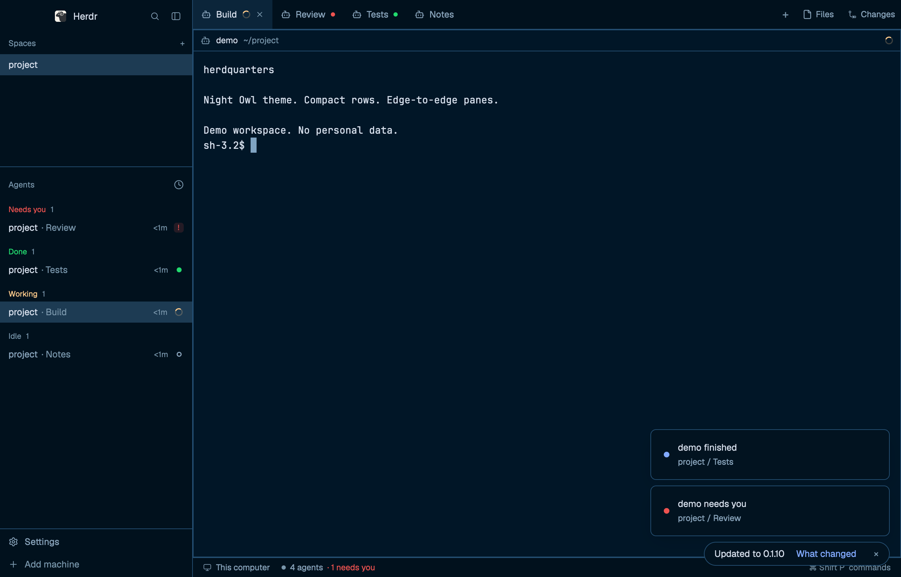

# herdquarters for Herdr

A compact Herdr layout with a Night Owl dark theme. Spaces and agents are shown without avatars or program icons. Sidebar rows and square, borderless tabs extend to the edges. Panes have no outer padding, split gaps, or focused-border highlight.



## Install

Requires the Herdr desktop app and its built-in mods. Tested with Herdr 0.1.10. The layout and custom mods were cloned from Herdr 0.1.9 and 0.1.10 and do not automatically receive upstream changes.

Read the [official Herdr guide](https://herdr.dev/guide/) and your installed `~/.config/herdr-app/AGENTS.md` first. Before installing, review [RECIPE.md](RECIPE.md) and the files. The spaces mod runs read-only Git queries and `hc machine ls`, including queries on connected remote machines, and watches local Git folders. The custom mods do not call `fetch`.

Run `./install.sh`, check each installed mod, then select `herdquarters` in Herdr:

```sh
for mod in compact-spaces compact-agents compact-footer compact-tabs; do
  herdr-app check "${HERDR_APP_HOME:-$HOME/.config/herdr-app}/mods/$mod" || exit 1
done
herdr-app do layout.switch '{"name":"herdquarters"}'
```

The installer does not switch layouts or overwrite files. If an installed file differs, it stops before copying anything. Resolve name clashes by renaming the new layout or mod and all its references, as the official guide describes. Set `HERDR_APP_HOME` to install to a different Herdr home. The files in this folder are separate from your installed copies, so later edits here do not automatically change the running app. The recipe and repository preview are not installed.

The layout follows Herdr's appearance setting: Night Owl in dark mode, Paper in light mode. The Night Owl terminal colors come from the [Night Owl theme](https://github.com/sdras/night-owl-vscode-theme).

## Files and behavior

- `layouts/herdquarters.json` defines the layout. `layouts/herdquarters.svg` is an illustration used in Herdr's layout picker.
- `mods/compact-spaces`, `mods/compact-agents`, `mods/compact-footer`, and `mods/compact-tabs` are customized copies of Herdr's spaces, agents, workspace-chrome, and tabs mods. Other panels and icons come from Herdr's built-in mods.
- `themes/night-owl.json` defines the theme.

The spaces mod runs `hc machine ls` and read-only Git status and repository queries, including on connected remote machines. It watches local Git directories for changes. The mods keep their own state in Herdr; personal spaces, terminal output, and settings are not included here.

Run `python3 tests/layout.py` to check the layout references, theme, recipe structure, and preview metadata. Run `tests/install.sh` to check installation and conflict handling without changing your Herdr home. If `herdr-app` is available, the test also checks the installed mods. Before publishing changes, run `gitleaks dir . --redact` and review images for personal content.

This repository follows [Herdr's layout sharing format](https://herdr.dev/layouts/): a named layout, its custom mods, a recipe, and a preview. It does not include personal settings, saved layout clicks, or runtime state. See [THIRD_PARTY.md](THIRD_PARTY.md) for the upstream code and theme licenses.
