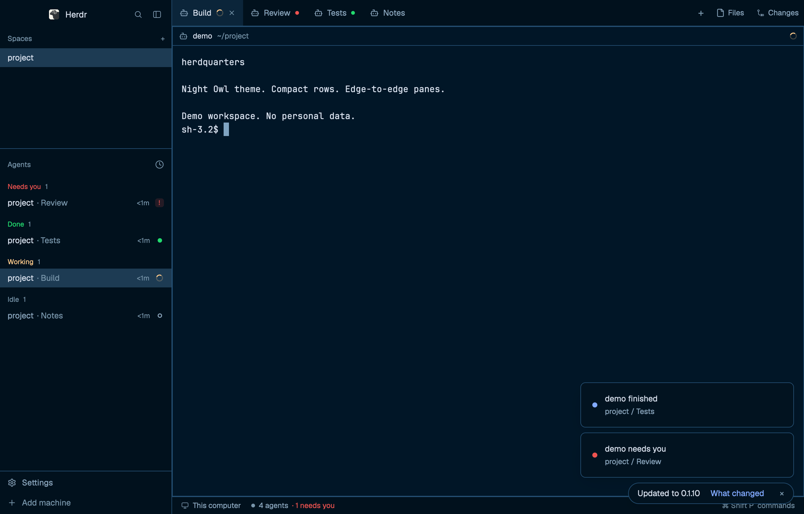

# herdquarters

Herdr's main layout with a Night Owl dark theme, no space avatars or agent program icons, edge-to-edge panes without a focused-border highlight, and square menus, dialogs, prompts, and confirmations.

## What you see

A 273px sidebar holds spaces above agents. Space names have no avatars; worktrees are indented under their checkout. Agent names have no program icons. Rows extend to the sidebar edges, with a 12px inset for text. Status markers, sort and pin controls remain. The sidebar can collapse to a numbered rail. The 69px footer has Settings and Add machine rows with 4px above, between and below them. Context menus, the new-tab menu, and dialogs are square with `chrome` backgrounds, `border` separators, 12px row insets, and Herdr's overlay frame removed. Herdr-owned overlays (Settings, palette, help, welcome, toasts, peek) keep their built-in frame.

The work area has a 42px tab bar, terminal panes, and status bar. Tabs fill the bar's height, have square corners and no border, and use a 12px horizontal inset for their contents. The active tab uses `raised` as its background. Panes have square corners, a 1px `border` color, no gap between splits, and a 30px header. Focus does not change the border color. Terminal text retains Herdr's `[14, 12]` padding.

In dark appearance, the `night-owl` theme uses `#011627` for the terminal background, `#d6deeb` for text and `#82aaff` for accents. Light appearance uses Herdr's `paper` theme.

## How it behaves

- Click a space to select it, drag a space to reorder it within its machine, or right-click for its square menu with rename, close (after confirmation), and Git worktree actions. Worktrees appear under their checkout. When remote machines exist, rows have foldable machine headers and a new-space control. The narrow rail shows space numbers and a filled dot for blocked or done, a small dot otherwise.
- Click an agent to focus its pane, or a sub-agent to peek at its terminal. Working agents have a native spinning icon. Blocked agents say "Needs you", or show "!" under that priority header. Done agents have a filled dot; idle agents have a hollow ring. A done agent stays in Done while viewed. A parent's priority includes its most urgent live sub-agent.
- Agents default to priority order. The square sort popup also offers grouping by space. Hover an agent row for its pin control; pinned rows stay above the rest. Group headers fold rows, and parent chevrons fold sub-agents. Rows show time since the latest status change when not showing a hovered pin.
- Click tabs to select, double-click for a square rename prompt, drag to reorder, right-click for their square menu, and use the active tab's close control to close it. Closing the last tab asks for confirmation. Tabs retain program icons and status markers. Scroll the tab bar vertically for previous or next tab. The plus opens a square new-terminal menu with new and open worktree actions. Files and Changes buttons toggle the right panel and remember the choice per space.
- Pane headers and the status bar retain Herdr's behavior; terminal right-click menus use the square menu. Settings opens the app settings, which keep Herdr's own frame. Add machine opens a square machine dialog; when a machine needs a password, host key, or herdr-core first, it opens a frameless terminal window with a compact `chrome` title bar. A ready update adds a dot beside Settings. Linux and Windows have tab-bar window controls; macOS keeps its native traffic lights.
- No keys are shipped. Existing Herdr shortcuts still apply, including `ctrl-shift-l` to switch layouts and `ctrl-shift-b` to toggle the sidebar. The sidebar's bottom control expands the narrow rail; its expanded label is currently empty.

## Built from

`layouts/herdquarters.json` is a clone of Herdr 0.1.9's `main`. The root is a row with a 1px `border` divider, no system title bar, and macOS traffic lights at `[12, 16]`. The 273px sidebar column has a 46px draggable `workspace-chrome` brand block, a nested column of spaces and agents with weights `0.54104066` and `1.4589593`, and a 69px footer. The lists each have a 90px minimum; the sidebar range is 44 to 480px. The work column has a 42px draggable tabs block, a zero-padding, zero-gap body row, and a 28px `workspace-status` block. The body has the active tab and a hidden 368px right panel, range 280 to 900px. Its `panel-body` stack holds `files` and `changes`, initially `files`. The tab's pane frame uses the built-in `pane` header, always shown above each pane including a lone pane. Its `terminal_menu` points at `compact-menu`, so terminal right-click menus use the square menu. It uses `themes/night-owl.json` and the picker illustration `layouts/herdquarters.svg`.

All ten custom mods default-export a `View`, use `gpui-kit` elements and `gpui-base` flex builders, and have `mod.json` with `place: "none"` and `cloned_from` provenance. They reference Herdr's built-in assets instead of packaging them.

- `compact-spaces` clones `spaces` from 0.1.9. It reads `spaces`, `machines`, `panes`, `layout`, `window`, and `theme`, and keeps shared `space.colors`. It uses `run` for `space.new`, `space.select`, and `space.move`, and `openOverlay` for `compact-menu` with `frame: "none"` and `{tab: "space", target: {id}}`. Its `hc(["machine", "ls", "--json"])` refreshes every 15 seconds and excludes temporary machines. `exec` runs read-only `git status --porcelain=v2 --branch` with optional locks and fsmonitor disabled, and `git rev-parse` queries for the top-level and common Git directory. Queries use each space's current folder and machine. `watchFolder` watches local Git folders; a 60-second fallback checks visible active-window repositories. A 250ms timer detects changes but only runs Git when due. Folded machine names are stored per mod.
- `compact-agents` clones `agents` from 0.1.9. It reads `agents`, `terminals`, `panes`, `focused`, `spaces`, `layout`, `window`, and `theme`. Shared `agents.sort` chooses grouping; `setAgentOrder` makes Herdr's agent navigation follow the displayed order. Status timestamps and pins use per-mod `localStorage`. A 30-second timer updates durations. `run` calls `pane.focus`, `terminal.peek`, and `layout.resize`; sidebar resizing uses shared `sidebar.width` and `sidebar.collapsed`. `openOverlay` opens its own `compact-agents` sort popup with `frame: "none"` and `{sortMenu: true}`, and `props` plus `closeOverlay` handle that alternate render. The rail is 76px on macOS to leave space for traffic lights, 44px elsewhere.
- `compact-footer` clones `workspace-chrome` from 0.1.10. It reads `layout`, `theme`, and `updates`, and runs `app.settings` or opens `compact-machine-add` with `frame: "none"` and `kind: "dialog"`. It references built-in workspace-chrome icons.
- `compact-tabs` clones `tabs` from 0.1.10. It reads `spaces`, `panes`, `layout`, `window`, `settings`, `theme`, and shared `workspace.panels`, defaulting to Files and Changes. It saves panel choices in per-mod `localStorage`. `run` calls `tab.move`, `tab.select`, `tab.close`, `tab.prev`, `tab.next`, `layout.select`, `layout.show`, `layout.hide`, and the window controls. `openOverlay` opens `compact-menu` for a tab, `compact-new-menu` for the plus, `compact-prompt` on rename, and `compact-confirm` when closing the last tab, all with `frame: "none"`. It references workspace-chrome, pane, files, changes, and tabs icons, plus live program icons.
- `compact-menu` clones `menu` from 0.1.11. It reads `spaces`, `panes`, `terminals`, `keys`, and `theme`, and runs read-only `git rev-parse` to decide whether a space is in a Git checkout. It lists Herdr's pane, tab, space, and global menu items, with ↑/↓, Enter, and Esc. Worktree items open `compact-worktree`; rename opens `compact-prompt`; space and last-tab close open `compact-confirm`. Rows are 31px, separated by `border` lines for destructive and theme groups.
- `compact-new-menu` clones `new-menu` from 0.1.11. It reads `spaces`, `panes`, `knownAgents`, `keys`, `window`, and `theme`; its Terminal, agent, New space, and worktree rows run `tab.new` or `space.new` and open `compact-worktree` with `frame: "none"`. It sets no overlay height: the popup grows to fit its rows, and the agent list caps at 300px (`max 9 rows`) and scrolls, with 6px bottom padding.
- `compact-worktree` clones `worktree` from 0.1.11. It reads `spaces`, `panes`, `theme`, and `home`, runs read-only `git worktree list`, `git for-each-ref`, `git rev-parse`, and `git status`, and creates or removes worktrees with `git worktree add` and `git worktree remove`. It then runs `space.new`, `space.select`, and `space.close`. Its 31px header matches the tab bar, and its rows, fields, and buttons are unrounded.
- `compact-machine-add` clones `machine-add` from 0.1.11. It reads `~/.ssh/config`, runs `hc machine ls --json` every few seconds while adding, and uses `hc machine add` and read-only `exec` to check macOS hosts. When an add needs a terminal, it opens a frameless window whose layout has a 30px `compact-machine-add` bar over the terminal. Rows, cards, and fields are unrounded and use `chrome` and `border`.
- `compact-prompt` clones `prompt` from 0.1.11. It reads `props` of `{title, value, command}`, edits with `InputState`, and runs the command with the new name on submit. Enter submits and Esc closes; its 31px header and input are unrounded.
- `compact-confirm` clones `confirm` from 0.1.11. It reads `props` of `{title, detail, command}`, runs the command on Enter or Yes, and closes on Esc or Cancel. Its 31px header and buttons are unrounded.

None of the custom mods uses `fetch`. `preview.png` is a screenshot made with demo data only; the SVG is a separate generic illustration.

## Watch out

- The layout and custom mods are snapshots, not live copies of Herdr's built-ins. Built-in mod and asset references require a compatible Herdr version.
- The theme picker can override the layout's appearance. Personal sidebar sizes, pins, terminal sessions, and other Herdr state are not packaged.
- Follow the installed `~/.config/herdr-app/AGENTS.md` for the running version. Shipped layouts and mods are read-only; install these separately. If a name is taken, rename the new file or mod and all references rather than overwrite. `install.sh` refuses conflicting files before copying anything.
- Built-in mods and assets required here include `workspace-chrome`, `workspace-status`, `pane`, `files`, `changes`, and `tabs`. The six overlay mods are snapshots of Herdr 0.1.11's `menu`, `new-menu`, `worktree`, `machine-add`, `prompt`, and `confirm`; the custom snapshots may need rebuilding for newer Herdr APIs. No external program is required beyond Git and Herdr's `hc`.
- Herdr-owned screens and overlays cannot be restyled by a layout. Settings, the command palette, help, welcome, toasts, peek, and prompts opened by Herdr itself keep their rounded frame; only overlays opened by these mods use the square style.
- Do not publish Herdr's `settings.json`, `shared.json`, `data/`, `view.json`, `layouts/.state/`, machine configuration, or real terminal screenshots. The repository preview uses a separate demo environment.

## Done when

- `python3 tests/layout.py` passes for layout references, terminal menu, theme colors, recipe sections, overlay mod manifests, and preview metadata.
- `tests/install.sh` passes for a fresh install, a repeat install, and a conflicting file.
- All ten custom mods pass `herdr-app check` after installation.
- Switching to `herdquarters` shows icon-free space and agent rows, panes without outer gaps or focus-colored borders, and square menus, dialogs, prompts, and confirmations with no rounded overlay frame, and no errors in `herdr-app status`. Right-clicking a terminal opens the square menu.
- The layout picker resolves `layouts/herdquarters.svg`, and the Night Owl theme has 16 terminal ANSI colors. Both dark and light appearance render readable panels.
- Tabs, space and agent selection, sort and pin controls, pane headers, and Files and Changes toggles work in the app. A screenshot for sharing contains only demo names and terminal text.
